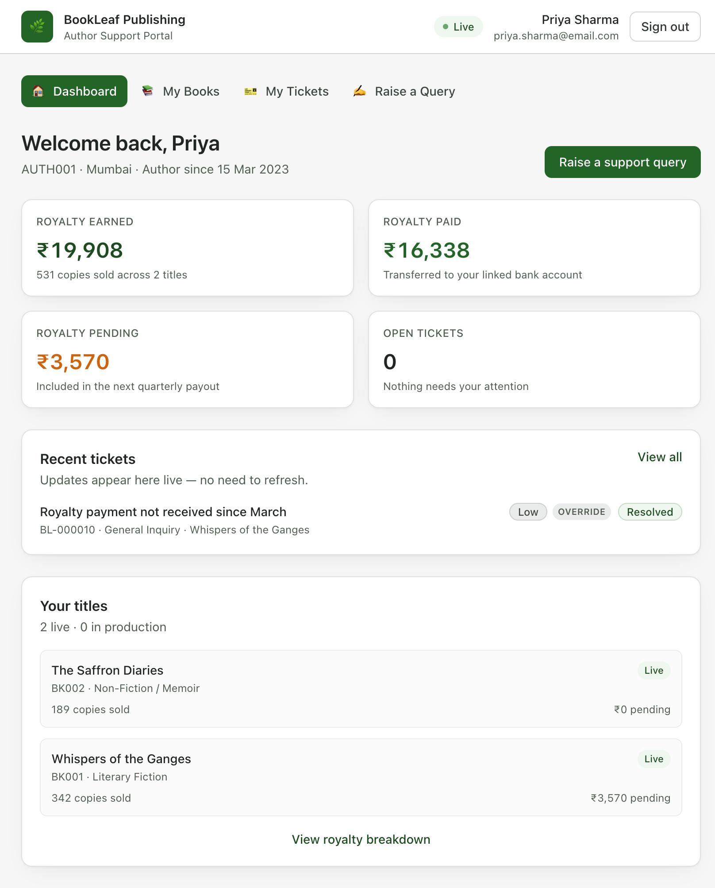
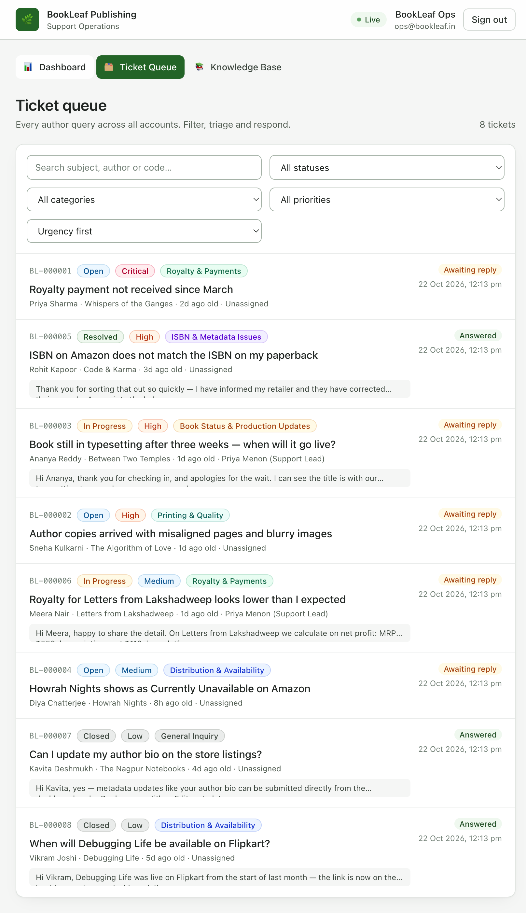
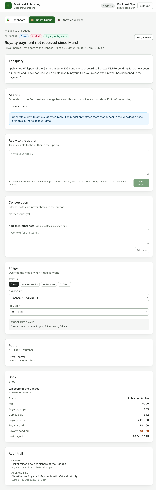
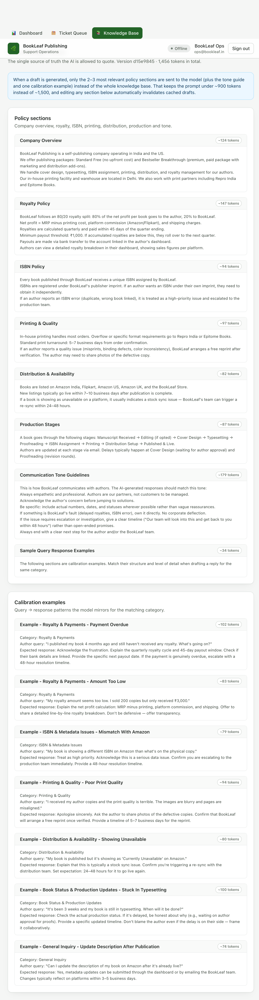
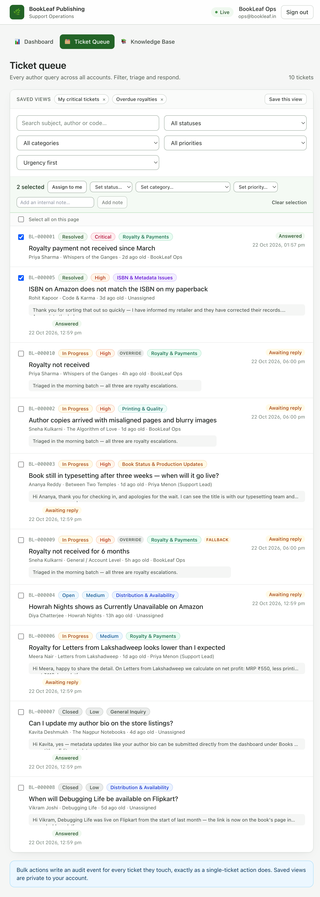

# BookLeaf — Author Support & Communication Portal

An author-facing and admin-facing support portal for BookLeaf Publishing, with AI-assisted
ticket classification, prioritisation and reply drafting.

The problem it solves: BookLeaf processes 1,200+ books a month and answers thousands of author
queries by hand — about royalties, book status, ISBNs and print quality. Queries arrive in a
spreadsheet, replies are inconsistent, and the backlog grows during busy periods. This portal
gives authors a place to see their books and royalties and track every query in real time, and
gives the ops team a queue that is automatically triaged and a first draft that is already
grounded in BookLeaf's own policy.

---

> **Looking for the requirements checklist?** Every line of the assignment brief is mapped to the
> code that implements it in **[docs/REQUIREMENTS.md](docs/REQUIREMENTS.md)** — what is done, where
> it lives, and the two items still outstanding (publishing the repo and deploying).

## Table of contents

- [Screenshots](#screenshots)
- [Tech stack](#tech-stack)
- [Quick start](#quick-start)
- [Demo credentials](#demo-credentials)
- [What is implemented](#what-is-implemented)
- [Architecture](#architecture)
- [AI integration](#ai-integration)
- [API reference](#api-reference)
- [Data model](#data-model)
- [Real-time updates](#real-time-updates)
- [Security](#security)
- [Testing](#testing)
- [Deployment](#deployment)
- [Assumptions and known limitations](#assumptions-and-known-limitations)
- [Project layout](#project-layout)

---

## Screenshots

| Author dashboard | Admin ticket queue |
|---|---|
|  |  |

| Admin ticket detail (AI draft, triage, audit trail) | Knowledge base the model is allowed to quote |
|---|---|
|  |  |



---

## Tech stack

| Layer | Choice | Why |
|---|---|---|
| Backend | **Spring Boot 3.3 / Java 21** | Strong validation and security story, first-class OpenAPI generation, SSE support out of the box. |
| Persistence | **PostgreSQL 16 + Flyway + JPA (Hibernate)** | Schema is owned by versioned migrations; Hibernate runs in `validate` mode so the mapping can never drift from the schema. |
| Frontend | **React 18 + TypeScript + Vite + Tailwind + TanStack Query** | Fast to build, typed end to end, small runtime. |
| Real-time | **Server-Sent Events** | Traffic is one-directional (server → client), works through any proxy, and reconnects by itself. |
| AI | **Provider-agnostic adapter** (Anthropic Claude / OpenAI) | Swapping the model is a configuration change, not a code change. |

Everything ships as **one container** serving the API and the compiled SPA from the same origin —
no CORS, and the httpOnly refresh cookie works without extra configuration.

---

## Quick start

### Option A — Docker (closest to production)

```bash
git clone <your-repo> bookleaf && cd bookleaf
docker compose up -d --build
open http://localhost:8080
```

The compose file starts PostgreSQL (creating both the `bookleaf` and `bookleaf_test` databases),
builds the SPA, builds the jar, runs the migrations and seeds the sample data.

### Option B — Local development (hot reload for the UI)

Requires JDK 21+, Maven 3.9+, Node 20+ and a PostgreSQL 14+ instance.

```bash
./scripts/setup.sh          # .env, the databases and npm install
./scripts/dev-backend.sh     # terminal 1 — http://localhost:8080
./scripts/dev-frontend.sh    # terminal 2 — http://localhost:5173
```

`setup.sh` creates the `.env` file, the PostgreSQL role and both the `bookleaf` and
`bookleaf_test` databases, and installs the frontend dependencies. The Vite dev server proxies
`/api` to the backend, so the browser only ever talks to one origin and the refresh cookie works
without any CORS setup.

<details>
<summary>Manual equivalent</summary>

```bash
createdb bookleaf
psql -d postgres -c "CREATE ROLE bookleaf LOGIN PASSWORD 'bookleaf';"

cd backend
DB_URL=jdbc:postgresql://localhost:5432/bookleaf \
DB_USERNAME=bookleaf DB_PASSWORD=bookleaf \
JWT_SECRET=local-dev-secret-at-least-32-characters-long \
mvn spring-boot:run

cd ../frontend && npm install && npm run dev
```

</details>

### Option D — IntelliJ IDEA

A dedicated step-by-step guide (import, JDK 21, database, `.env`, run configuration, the
frontend, and troubleshooting) is in **[docs/INTELLIJ.md](docs/INTELLIJ.md)**.

Short version:

```bash
./scripts/setup.sh          # .env, the databases, npm install
```

1. IntelliJ → **File → Open** → the `backend/` folder (so IntelliJ detects the Maven project).
2. **File → Project Structure** → SDK → **21**.
3. **Run → Edit Configurations** → `+` → **Spring Boot** → main class
   `com.bookleaf.portal.BookLeafPortalApplication`, working directory = the **repository root**
   (so the `.env` is found), JRE 21.
4. Run it. Then in the terminal: `cd frontend && npm run dev` → http://localhost:5173

### Option C — Run the API only, with the built SPA served by Spring Boot

```bash
cd frontend && npm ci && npm run build
rm -rf backend/src/main/resources/static && mkdir -p backend/src/main/resources/static
cp -R frontend/dist/. backend/src/main/resources/static/
cd ../backend && mvn spring-boot:run     # http://localhost:8080
```

### Configuration

All configuration is environment driven; nothing sensitive is compiled in. Copy
[`.env.example`](.env.example) to `.env` for the full list — `scripts/setup.sh` does this for you.
`.env` is gitignored.

| Variable | Default | Notes |
|---|---|---|
| `DB_URL`, `DB_USERNAME`, `DB_PASSWORD` | local Postgres | |
| `JWT_SECRET` | dev placeholder | **Must** be overridden in any deployed environment (32+ chars). |
| `SECURE_COOKIES` | `false` | Set `true` in production so the refresh cookie is HTTPS-only. |
| `SEED_ENABLED` | `true` | Seeds the supplied sample dataset and two demo admins. |
| `SEED_AUTHOR_PASSWORD` / `SEED_ADMIN_PASSWORD` | `Author@1234` / `Admin@1234` | Demo passwords. |
| `ANTHROPIC_API_KEY` / `OPENAI_API_KEY` | empty | Empty ⇒ the portal runs in deterministic fallback mode with no outbound calls. |
| `OPENAI_BASE_URL` | `https://api.openai.com` | Point at Ollama (`http://localhost:11434`) or any OpenAI-compatible endpoint. |
| `AI_PROVIDER` | `auto` | `auto` picks whichever key is present; `anthropic`, `openai` or `none` to force one. |
| `AI_KB_TOP_SECTIONS` | `3` | How many knowledge-base sections are retrieved per draft. |
| `CORS_ALLOWED_ORIGINS` | localhost:5173 | Only needed if the SPA is served from a different origin. |

---

## Demo credentials

| Role | Email | Password |
|---|---|---|
| Author | `priya.sharma@email.com` | `Author@1234` |
| Author | `rohit.kapoor@email.com` | `Author@1234` |
| Admin | `ops@bookleaf.in` | `Admin@1234` |
| Admin (support lead) | `priya.support@bookleaf.in` | `Admin@1234` |

All ten seeded authors share the password `Author@1234`. The demo data includes eight realistic
tickets across every category, priority and status so the queue, filters and live stream have
something to show immediately.

---

## What is implemented

### Author portal

- **Login** — email and password. Access token in memory, refresh token in an httpOnly cookie.
- **Dashboard** — royalty earned / paid / pending, copies sold, open ticket count, recent tickets
  and a live list of titles.
- **My Books** — every title with ISBN, genre, publication date, status, MRP, copies sold,
  royalty earned / paid / pending, print partner and the platforms it is listed on. Titles still
  in production legitimately have no MRP or royalty rate; the UI says *“not applicable yet”*
  instead of showing a fake zero.
- **Raise a query** — book dropdown (including *General / Account Level*), subject, description and
  an optional file attachment. The ticket is classified and prioritised automatically on creation.
- **My Tickets** — status filters, live updates, ticket threads with admin replies, and the author
  can add follow-ups. Replies appear without a refresh.

### Admin portal

- **Queue** — every ticket across all authors, filterable by status, category, priority, assignee
  and free text (subject, description, author, code), sortable by urgency or age, paginated.
  Critical and high priority tickets sort to the top; overdue work is highlighted. Rows are
  selectable so a batch can be triaged, assigned or closed in one action.
- **Auto-classification** — every new ticket is categorised into one of the six categories the
  brief defines. The admin can override it; overrides are marked *Override* in the UI and recorded
  in the audit trail.
- **Priority score** — Critical / High / Medium / Low, assigned automatically from the ticket
  content, overridable, with the model's reasoning shown.
- **AI draft** — a suggested reply grounded in the BookLeaf knowledge base and the author's live
  account data, generated on demand, editable before sending.
- **Ticket management** — status transitions, assignment to self, public replies, and internal
  notes that are never visible to the author.
- **Bulk actions** — select tickets and assign, re-status, re-categorise, re-prioritise or note
  them in one action. Every change is written to the audit trail individually, exactly as a
  single-ticket action would be.
- **Saved views** — store the filters you work with every day ("Overdue royalties", "My critical
  tickets") and re-apply them with one click. Saved views are private to your account.
- **Audit trail** — every creation, classification, override, assignment, reply and status change
  is recorded with actor and timestamp.
- **Operations dashboard** — open / in-progress / resolved counts, tickets awaiting a first reply,
  tickets breaching the 48-hour promise, average first-response time, and the AI usage panel.
- **Knowledge base viewer** — the exact policy content the model is allowed to rely on, with the
  token cost of each section.

---

## Architecture

```
bookleaf/
├── backend/                       Spring Boot API
│   └── src/main/java/com/bookleaf/portal/
│       ├── ai/                    AI layer: gateway, providers, prompts, knowledge base
│       ├── config/                Security, OpenAPI, typed properties, data seeder
│       ├── domain/                JPA entities and enums
│       ├── dto/                   Request/response records
│       ├── exception/             Error handling
│       ├── repository/            Spring Data repositories and specifications
│       ├── security/              JWT issuing, verification and the security filter
│       ├── service/               Domain services and the ticket lifecycle
│       └── web/                   REST controllers
├── frontend/                      React SPA
│   └── src/
│       ├── api/                   Typed API client, endpoints, SSE reader
│       ├── auth/                  Auth context and route guards
│       ├── components/            Shared UI
│       └── pages/                 Author and admin screens
├── data/                          The supplied sample dataset, verbatim
├── docs/                          Write-up and screenshots
├── Dockerfile                     Multi-stage build (SPA → jar → JRE)
├── docker-compose.yml             PostgreSQL + the full application
└── render.yaml                    One-click Render blueprint
```

### Decisions and why

**A single deployable.** The SPA is compiled into the Spring Boot jar. One origin means no CORS
configuration, cookies work unchanged, and there is no second service to keep alive.

**Transactions are kept away from the LLM.** The ticket services are split three ways:

- `TicketCommandService` — owns every write, each in a short transaction.
- `TicketQueryService` — owns every read, each in a read-only transaction.
- `TicketService` — orchestrates; **holds no transaction**.

This matters because a ticket creation performs a network round trip to an LLM. Holding a database
transaction (and its locks) open across that call would be a poor design in production. The split
also avoids a subtle bug class: `LazyInitializationException` when an entity is touched outside an
open session, which is exactly what happens when a method annotated `@Transactional` is called
from within the same bean (the Spring proxy is bypassed).

**JPA Specifications for the queue.** The admin queue has seven optional filters. Expressing them
as one dynamic JPQL query with `:param is null` predicates fails on PostgreSQL with
*“could not determine data type of parameter”*. Composable `Specification<Ticket>` objects avoid
the problem and are individually testable.

**Flyway owns the schema.** `spring.jpa.hibernate.ddl-auto=validate` means the application refuses
to start if the mapping and the migrated schema disagree — a schema change cannot silently diverge.

**Null means “not applicable”, not zero.** Books in production have a `null` MRP and royalty rate.
The DTOs keep that distinction so the UI can say so honestly.

---

## AI integration

This is the part the brief weights most heavily, so it is worth being explicit about what was
built and why.

### Three separate jobs, three different shapes

| Job | Endpoint | Model | Output |
|---|---|---|---|
| Triage | automatic, on ticket creation | cheap fast model | JSON: category, priority, rationale, signals |
| Draft | on demand, admin clicks *Generate draft* | same or stronger model | plain prose reply |

### One call, two decisions

Category and priority are requested **in a single structured-output call** rather than two
separate ones. Every new ticket triggers a classification, so halving the round trips and prompt
tokens there is the single biggest cost lever in the system.

The triage prompt asks for raw JSON with a fixed schema and a fixed category vocabulary, and asks
for a rationale that must cite the specific phrase or number from the ticket that drove the
decision. That rationale is stored on the ticket and shown to the admin, so a human can sanity-check
the model in seconds rather than trusting a bare label.

The prompt also encodes a **priority rubric**, not just a category list, so the model has a
policy to apply rather than a vibe to imitate — for example *“CRITICAL — money already lost:
royalties unpaid beyond the 45-day payout window”* and *“ISBN errors are high priority per BookLeaf
policy”*.

### Grounding: the model may only state what we gave it

The drafting prompt is split into four blocks:

1. **TICKET** — subject, description, category, priority, book.
2. **ACCOUNT CONTEXT** — the author's real books with real figures (MRP, royalty per copy, copies
   sold, royalty earned / paid / pending, last payout date, print partner, platforms).
3. **POLICY CONTEXT** — only the knowledge-base sections relevant to this ticket.
4. **CALIBRATION EXAMPLE** — the sample query → expected response for this category, so the model
   mirrors the expected *structure and level of detail* rather than only the tone rules.

The system prompt states the grounding rule explicitly:

> Policy context is the only source of BookLeaf policy you may state. Do not invent policies,
> timelines, fees or processes that are not written there. If the question is not covered by the
> context, do not guess — say what you need to check internally and give a 48-hour timeline.

This is why drafts contain real numbers (*“your ₹3,570 pending royalty”*) rather than
*“your royalty is being processed”*, and why they own mistakes directly when BookLeaf is at fault.

### Measured behaviour

Accuracy was measured against a labelled set of ten tickets (covering all six categories and all
four priorities) with `scripts/measure_triage.py`:

| Provider | Category | Priority | Cost per ticket | Notes |
|---|---|---|---|---|
| **Llama 3.1 8B** (Ollama, free and local) | **10/10** | **10/10** | ~735 prompt + ~55 completion tokens | The model the app was tuned against |
| **Heuristic fallback** (no AI at all) | **10/10** | 8/10 | 0 tokens, ~0 ms | The rules BookLeaf's policy implies |

Prompt cost, measured from the usage log:

| | Prompt tokens | Completion tokens | KB context | Latency (local 8B) |
|---|---|---|---|---|
| Triage | ~735 | ~55 | — | ~10 s |
| Draft | ~1,472 | ~221 | 537 of 1,456 KB tokens | ~50 s |

**The prompt was rewritten because the measurements said so.** The first version of the triage
prompt described the priority rubric in prose. It classified perfectly (10/10 category) but scored
priority at only **3/10** — it systematically under-prioritised, landing on Medium almost every
time. The fix was to restructure the prompt into three explicit steps — *pick the category → take
the category's default priority → escalate only on a stated concrete fact* — which moved priority
accuracy to **10/10** without touching the category rules. The rubric, the escalation triggers and
the category defaults are all visible in `Prompts.TRIAGE_SYSTEM`.

Two further bugs were found this way and fixed: the AI cache key ignored the system prompt, so a
prompt fix kept serving stale answers; and `AI_PROVIDER=none` was not honoured, so the AI could
not be switched off for testing.

### Cost management

| Technique | Effect |
|---|---|
| **Retrieval instead of dumping the KB** | The knowledge base is ~1,456 tokens. Retrieval sends the 2–3 relevant policy sections plus the short tone guide — 537 tokens of context instead of 1,456. |
| **One triage call, not two** | Halves the cost of classifying every inbound ticket. |
| **Capped output** | Triage is capped at 300 completion tokens, drafts at 700. |
| **Content-addressed cache** | Results are cached under `sha256(purpose + model + system prompt + user prompt)`. Because the retrieved knowledge base is embedded in the prompt, editing the knowledge base automatically invalidates every cached answer — and so does editing a prompt, which is exactly what you want. A repeated ticket costs nothing: 36 of 71 calls in the measurement run were served from the cache. |
| **Cheap model for triage** | The triage model is configurable separately from the draft model (`AI_TRIAGE_MODEL` / `AI_DRAFT_MODEL`). |
| **Usage accounting** | Every call is logged with prompt tokens, completion tokens, latency and success. The admin dashboard shows the totals, the cache-hit rate and the average latency — cost is visible, not assumed. |

The retrieval itself is a deterministic lexical scorer (title hits weighted above body hits) with
no embedding cost and no vector database to run. It is deliberately simple: it is easy to explain
in a code review, easy to test, and swapping in a vector store later only requires changing
`KnowledgeBaseService`.

### Graceful degradation

This is treated as a first-class requirement, not an error case.

| Failure | What happens |
|---|---|
| No API key configured | The provider resolves to `none`. Tickets are classified by `HeuristicTriageService` (deterministic keyword rules that encode the same BookLeaf policy). No draft is offered; the admin panel explains why and the ticket is fully usable. |
| Provider down / rate limited / timeout | `AiUnavailableException` is caught. Triage falls back to the rules and records the reason on the ticket. Draft generation returns `{ available: false, note: "…" }` — never an HTTP 500. The admin writes the reply by hand. |
| Model returns unusable output | The JSON is validated against the known enum vocabulary; if it does not parse, the service falls back to the rules. |
| Provider fails mid-session | The failure is counted in the AI usage panel, and the admin dashboard shows the failure rate. |

**The ticket is always created.** AI is an accelerant, never a gate.

The fallback classifier is not a toy — it encodes the brief's own policy (ISBN errors are high
priority; six months of unpaid royalty is critical) and has its own unit test suite
(`HeuristicTriageServiceTest`) that pins the behaviour.

### Model choice

The default is **Anthropic Claude Haiku** (`claude-3-5-haiku-latest`) with **OpenAI `gpt-4o-mini`**
as a first-class alternative; the provider is selected from configuration, not code.

The reasoning:

- **Both tasks are small and well-specified.** Triage is a classification with a fixed label set
  and a rubric; drafting is a 150-word reply with a supplied context. Neither needs a frontier
  model, and the brief calls for cost-consciousness.
- **The prompt asks for grounded prose, not reasoning.** The heavy lifting is done by the retrieval
  and the account context, so a small model suffices — a **free local Llama 3.1 8B** classifies at
  10/10 on the benchmark above.
- **Provider neutrality is cheap insurance.** BookLeaf should not be locked to one vendor, and the
  gateway keeps the vendor boundary in one place (`AiClient`), so the rest of the application never
  depends on a vendor SDK.
- **The model is configurable per job.** `AI_TRIAGE_MODEL` and `AI_DRAFT_MODEL` can point at
  different models, so triage can stay on the cheapest option while drafts use something stronger.

### Running the AI for free

The portal needs **no paid API key** to be fully functional. Three options, in order of
recommendation:

**1. A free local model via Ollama (recommended for development).** Ollama exposes an
OpenAI-compatible API, so the existing OpenAI adapter talks to it with no code change:

```bash
brew install ollama
ollama serve
ollama pull llama3.1          # ~5 GB, runs fine on an 8 GB Apple Silicon machine
```

```bash
# .env
OPENAI_API_KEY=ollama
OPENAI_BASE_URL=http://localhost:11434
OPENAI_MODEL=llama3.1
```

**2. A free cloud tier.** Google Gemini (`gemini-2.0-flash`) and OpenRouter's `:free` models both
have free tiers and both speak the OpenAI chat-completions format, so they work with the same
adapter:

```bash
OPENAI_BASE_URL=https://openrouter.ai/api/v1
OPENAI_MODEL=meta-llama/llama-3.1-8b-instruct:free
```

**3. No provider at all.** Leave both keys empty and the portal runs in deterministic fallback
mode: tickets are still classified (by the rules), the queue, the drafts-by-hand workflow and
every other feature still work — only the AI draft button is disabled, with an explanation.

---

## API reference

The full, always-current specification is generated from the code:

- **Swagger UI** — http://localhost:8080/swagger-ui.html
- **OpenAPI JSON** — http://localhost:8080/v3/api-docs

A condensed reference is in [`docs/API.md`](docs/API.md).

| Method | Path | Role | Purpose |
|---|---|---|---|
| `POST` | `/api/v1/auth/login` | public | Sign in, returns an access token + sets the refresh cookie |
| `POST` | `/api/v1/auth/refresh` | public | Redeem the refresh cookie for a new access token |
| `POST` | `/api/v1/auth/logout` | any | Clear the refresh cookie |
| `GET` | `/api/v1/auth/me` | any | The signed-in user's profile |
| `GET` | `/api/v1/author/dashboard` | author | Dashboard with royalty totals and recent tickets |
| `GET` | `/api/v1/author/books` | author | The author's books with royalty figures |
| `GET` | `/api/v1/author/books/{id}` | author | One book |
| `GET` | `/api/v1/author/tickets` | author | The author's tickets, newest first |
| `GET` | `/api/v1/author/tickets/{id}` | author | One ticket thread (internal notes excluded) |
| `POST` | `/api/v1/author/tickets` | author | Raise a ticket (auto-classified) |
| `POST` | `/api/v1/author/tickets/{id}/replies` | author | Add a follow-up |
| `GET` | `/api/v1/admin/tickets` | admin | The queue — filter by status, category, priority, assignee, date, text |
| `GET` | `/api/v1/admin/tickets/{id}` | admin | Full ticket incl. internal notes and audit trail |
| `PUT` | `/api/v1/admin/tickets/{id}/status` | admin | Change the status |
| `PUT` | `/api/v1/admin/tickets/{id}/category` | admin | Override the AI classification |
| `PUT` | `/api/v1/admin/tickets/{id}/priority` | admin | Override the AI priority |
| `POST` | `/api/v1/admin/tickets/{id}/assign` | admin | Assign to the signed-in admin |
| `POST` | `/api/v1/admin/tickets/{id}/replies` | admin | Send a reply to the author |
| `POST` | `/api/v1/admin/tickets/{id}/notes` | admin | Add an internal note (never shown to the author) |
| `POST` | `/api/v1/admin/tickets/{id}/draft` | admin | Generate an AI draft reply |
| `GET` | `/api/v1/admin/dashboard` | admin | Queue stats, urgent tickets, AI usage |
| `GET` | `/api/v1/admin/ai-usage` | admin | AI cost and reliability summary |
| `GET` | `/api/v1/admin/ai-usage/recent` | admin | Recent individual AI calls |
| `GET` | `/api/v1/stream/tickets` | any | SSE stream of ticket updates |
| `GET` | `/api/v1/meta` | public | Reference data and AI provider status |
| `GET` | `/api/v1/meta/knowledge-base` | public | Knowledge base sections and token counts |

### Error format

Every error has the same shape, and validation failures are reported per field rather than as a
generic 400:

```json
{
  "timestamp": "2026-10-22T06:26:25.741417Z",
  "status": 400,
  "error": "Validation Failed",
  "message": "One or more fields are invalid",
  "path": "/api/v1/author/tickets",
  "fieldErrors": {
    "subject": "Subject must be between 5 and 200 characters",
    "description": "Description must be between 20 and 8000 characters"
  }
}
```

Unexpected errors are logged with a correlation id that is returned to the client, and never leak a
stack trace.

---

## Data model

```
app_user ──1:1──► author ──1:N──► book ──1:N──► book_platform
                        │                (the platforms a title is listed on)
                        └──1:N──► ticket ──1:N──► ticket_message
                                        │        (public replies and internal notes)
                                        └──1:N──► ticket_event   (immutable audit trail)

ai_usage_log   every LLM call: tokens, latency, success, cache hit
ai_cache_entry content-addressed cache of AI results
```

`ticket.priority_rank` is a numeric mirror of the priority enum so the queue can sort by urgency in
SQL — sorting on the enum name alphabetically would put `CRITICAL` and `HIGH` after `LOW`.

---

## Real-time updates

`GET /api/v1/stream/tickets` is a Server-Sent Events stream. On every meaningful ticket change the
backend publishes an event; the browser receives it and refetches the affected view.

- **Admins** receive every ticket event.
- **Authors** receive only events for their own tickets. The authorisation decision is made at
  publication time in `TicketEventPublisher`, so an author cannot receive another author's ticket
  even by tampering with the client.

`EventSource` cannot send an `Authorization` header, so the client reads the stream with `fetch`
and parses the `text/event-stream` framing itself — which also gives us an `AbortController` for
clean teardown and reconnection. The server sends a keep-alive comment every 25 seconds so proxies
do not close idle connections.

---

## Security

- **Stateless JWT.** A 30-minute access token is sent in the `Authorization` header; a 7-day
  refresh token lives in an httpOnly, `SameSite=Strict` cookie that JavaScript cannot read. The
  token type claim stops a refresh token being replayed as an access token.
- **The access token is never stored in `localStorage`** — it is held in memory, so an XSS bug
  cannot exfiltrate it from persistent storage.
- **Role-based access control.** `/api/v1/admin/**` requires `ROLE_ADMIN`; every other API route
  requires authentication. The React route guards mirror this for UX only — the API is the
  authority.
- **Authors are scoped to their own data** at the query level, not by filtering the response. A
  ticket belonging to another author returns **404, not 403**, so an author cannot probe for the
  existence of other authors' tickets.
- **Internal notes are filtered server side.** The author-facing DTO is built from a query that
  never selects internal notes at all.
- **Passwords** are hashed with BCrypt (cost 10). Login failures return the same message for an
  unknown email and a wrong password.
- **API keys live only in environment variables.** They are read by `AppProperties` on the server
  and are never sent to the browser; the frontend only ever sees the *provider name* and the
  *model name* via `/api/v1/meta`.
- **Parameterised queries everywhere** — no string-concatenated SQL.

---

## Testing

```bash
cd backend && mvn test       # 50 backend tests
cd frontend && npm test      # 13 frontend tests
```

The integration tests switch the AI layer off (`app.ai.provider=none`) so the suite never depends
on an external service — it stays fast and deterministic, and exercises the fallback path. The AI
prompt and parsing logic are covered separately by `AiTriageServiceTest` with a stubbed gateway.

Backend — 50 tests, all passing:

| Suite | What it covers |
|---|---|
| `AuthApiTest` | Login success and failure, generic error message, field-level validation, protected routes, `/auth/me` |
| `AuthorTicketApiTest` | Auto-triage on creation, authors only seeing their own tickets, cross-author access returning 404, admin routes returning 403, a ticket cannot reference another author's book, dashboard aggregation, book scoping |
| `AdminTicketApiTest` | Queue listing and filtering, unknown filter values returning 400, category/priority overrides, replies reaching the author, **internal notes never reaching the author**, status audit trail, assignment, graceful draft degradation, dashboard stats |
| `AdminBulkActionsApiTest` | Bulk actions applying to every selected ticket, per-ticket audit events, unchanged tickets left alone, bulk notes staying internal, empty/no-action requests rejected, authors being blocked, and the saved-filter lifecycle including duplicate names and per-admin privacy |
| `AiTriageServiceTest` | The AI path with a stubbed gateway: valid output parsed, markdown-fenced JSON parsed, unknown category falling back, unparseable output falling back, provider outage falling back, no provider falling back |
| `HeuristicTriageServiceTest` | The fallback classifier against each of the six categories and the priority rubric |
| `KnowledgeBaseServiceTest` | Knowledge-base parsing, retrieval relevance, and that retrieved context is smaller than the whole KB |

The integration tests run against a **real PostgreSQL** with the Flyway migrations applied, so the
schema under test is exactly the schema that ships. The test database is created on demand and
truncated between tests. Point it elsewhere with `TEST_DB_URL`.

Two bugs were found by these tests during development and fixed: the retrieval scorer was letting
calibration examples crowd out the actual policy sections, and a `can I update …` query was being
scored Medium instead of Low.

The frontend has 13 unit tests covering the formatting helpers (including the "null means not
applicable, never a fake zero" rule) and the query-string builder.

---

## Deployment

### Render (one click)

The repository contains a `render.yaml` blueprint.

1. Push the repository to GitHub.
2. In Render: **New → Blueprint**, select the repository, apply.
3. Add `ANTHROPIC_API_KEY` (or `OPENAI_API_KEY`) to the web service as a secret.

The blueprint creates a Docker web service (serving the API and the SPA) plus a managed Postgres.
`JWT_SECRET` is generated automatically; `SECURE_COOKIES` is set to `true`.

### Any Docker host

```bash
docker build -t bookleaf-portal .
docker run -p 8080:8080 \
  -e DB_URL=jdbc:postgresql://host:5432/bookleaf \
  -e DB_USERNAME=bookleaf -e DB_PASSWORD=... \
  -e JWT_SECRET=... -e SECURE_COOKIES=true \
  -e ANTHROPIC_API_KEY=... \
  bookleaf-portal
```

The image is a multi-stage build (Node → Maven → JRE), runs as a non-root user and ships a
`/actuator/health` health check.

### Before any deployment

- [ ] `JWT_SECRET` set to a strong random value (`openssl rand -base64 48`).
- [ ] `SECURE_COOKIES=true` (HTTPS-only refresh cookie).
- [ ] Database credentials from a secret manager, not the repository.
- [ ] `ANTHROPIC_API_KEY` / `OPENAI_API_KEY` set as a secret — **never** in code or in the image.
- [ ] `SEED_ENABLED` left `true` for the demo (it is idempotent), or `false` for a real deployment.

---

## Assumptions and known limitations

**Assumptions made**

1. *Author accounts are pre-created by BookLeaf.* The brief asks for email/password login with no
   sign-up, so the seeder creates the ten author accounts from the sample data with a shared demo
   password. In production these would be provisioned from BookLeaf's existing author system.
2. *Admin staff are internal.* Two admin accounts are seeded for the demo. Real deployment would
   provision them from the company's identity provider.
3. *One book per ticket.* The brief specifies a single book dropdown, so that is what was built;
   multi-book tickets would need a join table.
4. *`available_on` is normalised.* The sample JSON stores platforms as an array; it is stored in a
   `book_platform` table rather than a JSON column, so platforms can be queried and indexed.
5. *File attachments are UI only*, as the brief allows. The file name is recorded on the ticket and
   shown to the admin, but the bytes are not uploaded.

**Known limitations**

- **Attachment upload is not implemented** (UI only, per the brief).
- **Keyword retrieval, not semantic.** Lexical scoring is cheap and predictable but will miss a
  paraphrased policy question that shares no words with the section. A vector store or
   hybrid retrieval is the natural next step — `KnowledgeBaseService` is the only class that would
  change.
- **Tickets have no pagination on the author side.** An author with thousands of tickets would get
  a large payload. The admin queue is paginated; the author list is not.
- **The SSE hub is in-memory.** It works for a single instance, which is what the brief implies. A
  multi-instance deployment would need a shared broker (Redis pub/sub) so events fan out across
  nodes.
- **No rate limiting or CAPTCHA** on the login endpoint.
- **No per-platform sales breakdown.** The knowledge base mentions authors can see sales per
  platform; the sample dataset only provides a platform list, so the UI shows the platform list
  rather than invented figures.
- **The knowledge base is a markdown file.** It is versioned with the code, which is good for
  traceability, but a CMS would be better for non-engineers to edit.

---

## Project layout

```
bookleaf/
├── README.md
├── Dockerfile                    Multi-stage build
├── docker-compose.yml            PostgreSQL + app
├── render.yaml                   Render blueprint
├── data/bookleaf_sample_data.json    The supplied dataset, verbatim
├── docs/
│   ├── API.md                    Endpoint reference
│   ├── INTELLIJ.md               Step-by-step IntelliJ IDEA guide
│   ├── REQUIREMENTS.md           Assignment brief mapped to the code
│   ├── WRITEUP.md                One-page approach note
│   └── screenshots/
├── backend/
│   ├── pom.xml
│   ├── .env.example
│   └── src/
│       ├── main/java/com/bookleaf/portal/…
│       ├── main/resources/
│       │   ├── application.yml
│       │   ├── db/migration/V1__init_schema.sql
│       │   ├── knowledge/knowledge-base.md
│       │   └── data/bookleaf_sample_data.json
│       └── test/java/com/bookleaf/portal/…
└── frontend/
    ├── package.json
    ├── vite.config.ts
    └── src/…
```
